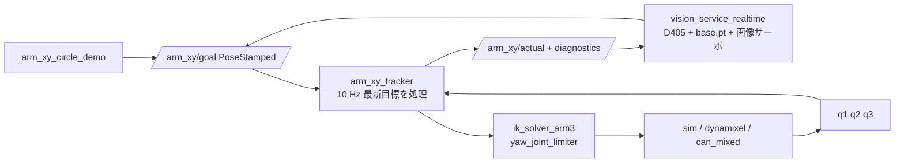

# アーム制御プログラム構成と設定ガイド

この資料は、現在のROS 2 Humbleワークスペースで使うXYアーム追従、円軌道デモ、CAN/Dynamixel構成と、設定方法をまとめたものです。通常の収穫サービス制御は既存経路として残っています。

## 1. 制御の全体像



円デモと画像追従はどちらも`/arm_xy/goal`を使います。同時に起動すると、目標発行元が競合するため、片方だけ起動してください。

| プログラム | 役割 |
|---|---|
| `arm_controller.py` | 既存のサービス式アーム制御。同期処理・通常の収穫タスク向け。今回の連続追従やCAN移行経路とは別です。 |
| `arm_controller_xy_tracker.py`（実行名`arm_xy_tracker`） | 10Hz周期で実測関節を読み、最新のPoseStamped目標だけにIKと関節制限を適用します。古い目標を順番に処理しません。 |
| `modules/ik_solver_arm3.py` | XY位置と平面内yawの3関節IK。任意の6自由度姿勢や衝突回避は扱いません。 |
| `modules/yaw_joint_limiter.py` | 関節速度・加速度・可動範囲と、`q1+q2+q3`で表すyawを一緒に制限します。 |
| `modules/stream_motor_backend.py` | 模擬バックエンドとDynamixel通信を実装します。 |
| `modules/can_mixed_backend.py` | q1/q2のRMD CAN制御とq3のDynamixel制御を関節座標の裏側にまとめます。 |
| `modules/joint_startup.py` | `startup_mode:=configured`時の設定済み初期姿勢への関節空間移動です。 |
| `xy_circle_demo.py`（実行名`arm_xy_circle_demo`） | 10Hzで円のPoseStamped目標を発行し、開始前に円周のIK・関節範囲を確認します。 |
| `vision_pkg/vison_sevice_realtime.py`（実行名`vision_service_realtime`） | D405、YOLO、深度、画面表示、画像サーボを1ノードで行い、アーム目標を発行します。 |
| `vision_pkg/modules/image_servo.py` | 対象の対応付け、深度検証、画素・距離誤差からXY速度を計算します。 |
| `modules/harvest_cycle.py` | 画像接近完了時の保持・アーム復帰状態機械です。収穫サイクルを無効にした通常追従・円デモには入りません。 |

### 関節と通信の対応

| ROS関節 | 現在のバックエンド | 補足 |
|---|---|---|
| q1 | RMD-X8-P20-120、CAN ID 0 | Uno R3 + MCP2515経由 |
| q2 | RMD-X6-P20-60、CAN ID 1 | Uno R3 + MCP2515経由 |
| q3 | Dynamixel ID 5 | 既存のq3変換を維持 |
| Z軸 | XY trackerの対象外 | 別系統。XY追従・円デモはZを動かさない |

上位制御はq1/q2/q3の関節角をradで扱います。旧Dynamixel 5モーター構成の対向モーターやID変換は`arm_controller.py`側の経路です。`can_mixed`ではq1/q2を旧Dynamixel ID 1～4へ指令しません。

## 2. 起動モードとバックエンド

| 設定 | 意味 |
|---|---|
| `backend:=sim` | 模擬モーター。実機アクチュエーターへ指令しません。 |
| `backend:=dynamixel` | Dynamixelバックエンド。 |
| `backend:=can_mixed` | q1/q2をUno経由のRMD CAN、q3をDynamixelで制御します。UnoのREADY、各モーターの状態、校正・関節範囲が起動条件です。 |
| `startup_mode:=current` | 実測関節位置を起点にします。設定済みホーム／デモウェイポイントへは移動しません。 |
| `startup_mode:=configured` | `xy_robot_config.yaml`の`home_joints_deg`、次に`demo_joints_deg`へ移動してからreadyになります。起動時にアームが動きます。 |

現在の設定済みウェイポイントはhome=`[5,170,-75]°`、demo=`[5,160,-65]°`です。各区間は最低3秒、到達許容差は各関節1°です。Z軸はこの移動でも動きません。

## 3. アーム周期制御の設定

ファイル: `config/xy_tracking_params.yaml`。ROSインターフェースの距離はm、角度はradです。

| パラメーター | 既定値 | 意味 |
|---|---:|---|
| `control_rate_hz` | 10.0 | trackerの関節状態読取り・IK・関節指令更新周期。画像処理のfpsとは別です。 |
| `goal_topic` | `/arm_xy/goal` | 最新手先目標の入力トピック。型は`geometry_msgs/msg/PoseStamped`です。 |
| `frame_id` | `arm_base` | 受け付ける座標系。別frameへのTF変換はせず、不一致は拒否します。 |
| `goal_timeout_sec` | 0.5 | この時間、新しい有効目標がなければ追従を止めて現在位置を保持します。 |
| `stamp_max_age_sec` | 2.0 | 受信する目標stampの最大過去時間。vision側にはより厳しい観測期限もあります。 |
| `stamp_future_tolerance_sec` | 0.2 | stampが現在時刻より未来でも受け付ける最大幅です。 |
| `max_goal_xy_m` | 1.0 | arm_base原点から見た目標XYの絶対値上限です。 |
| `plane_z_m` | 0.0 | 追従面のZ。異なるZ目標は受け付けません。 |
| `max_joint_velocity_rad_s` | 0.25 | 各関節指令速度の上限です。 |
| `max_joint_acceleration_rad_s2` | 0.8 | 各関節指令速度の変化率上限です。 |
| `tracking_position_tolerance_m` | 0.00001 | trackerでIK成功を判定する位置誤差許容値です。 |
| `tracking_angle_tolerance_rad` | 0.0001 | trackerでIK成功を判定するyaw誤差許容値です。 |
| `max_following_error_rad` | 0.15 | 送信関節指令と実測関節の差が超えたとき故障保持するしきい値です。 |
| `control_conflict_services` | `/arm_service`, `/arm_service_d435` | 既存サービス制御との同時指令を検出・抑止する対象です。 |

## 4. ロボット・IK・モーター設定

ファイル: `config/xy_robot_config.yaml`。

| 設定 | 現在値・意味 |
|---|---|
| `backend` | `sim`。通常はlaunchの`backend:=...`で上書きします。 |
| `startup.home_joints_deg` | `[5,170,-75]`度。configured起動の第1ウェイポイント。 |
| `startup.demo_joints_deg` | `[5,160,-65]`度。configured起動後の追従開始姿勢。yawは100°です。 |
| `startup.minimum_segment_duration_sec` | 3.0秒。初期姿勢間の最短移動時間。 |
| `startup.segment_timeout_sec` | 60秒。各ウェイポイント到達の上限時間。 |
| `startup.arrival_tolerance_rad` | 約1°。到達判定の関節許容差。 |
| `ik_solver_params.Link1..4` | `[270,61.75,275,75]` mm。IK内部のリンク／オフセット寸法。ROS目標はmです。 |
| `MAX_LOOP_NUM` | 80。通常IKの反復上限。 |
| `position_tolerance_m`, `angle_tolerance_rad` | 通常IKの位置・角度収束許容差。 |
| `max_joint_step_rad` | 1 IK反復の関節更新上限。 |
| `damping`, `angle_length_m` | 減衰付きIKの特異点対策と位置・角度誤差の重みづけに使います。 |

関節ソフトウェア制限はq1=`-10..180°`、q2=`-30..175°`、q3=`-165..135°`です。これは旧モーター設定から換算して引き継いだ範囲で、リンクを装着した機構の安全限界を測った値ではありません。

`can_mixed_backend`ではUnoのUSBシリアル番号`24236323730351504241`、115200 baud、通信timeout 0.8秒、RMD速度指令上限15 dpsです。`q1`/`q2`の`direction`、`reference_joint_deg`、`reference_motor_cdeg`でモーター角と関節角を対応させます。現在の値はリンク未装着試験で定義した基準です。リンクやモーター取付を変えたら再校正してください。DynamixelのU2D2シリアル番号・baud・ID・profile設定も同じYAML内にあります。

## 5. 円軌道デモ

起動ファイル: `launch/xy_circle_demo.launch.py`。既定バックエンドは`sim`です。円デモは円周144点で事前IK確認し、全周に解がなければ目標を出しません。

| Launch引数 | 既定値 | 意味 |
|---|---:|---|
| `radius` | 0.05 m | 半径。50 mmは今回CAN実機で一周確認した値です。 |
| `center_x`, `center_y` | 0.0 m | `center_mode:=configured`時の中心。 |
| `center_mode` | `current_start` | 現在位置から開始できるよう中心を計算し、初回に半径分の位置ジャンプを作りません。 |
| `period` | 20.0 s | 一周にかける時間。速度はROS clockの経過時間から算出します。 |
| `publish_rate` | 10.0 Hz | `/arm_xy/goal`発行レート。tracker周期とは別パラメーターです。 |
| `initial_phase` | 0 rad | 円上の開始角度です。 |
| `direction` | `1.0` | `+1`または`-1`。式の`theta`増減方向です。 |
| `revolutions` | 0 | 0は無限周回、正数は指定回数で完了します。 |
| `frame_id` | `arm_base` | 円目標の座標系です。 |
| `startup_mode` | `configured` | 円デモより前のアーム初期化方法です。 |

`center_mode:=configured`では指定中心へ移動してから円を開始します。開始点までの補間時間`approach_duration`はノード既定3秒ですが、現在のLaunch引数には公開されていません。手先yawは開始時の実測yawを全周固定します。Zも円開始時の実測値に固定します。

模擬の一周:

```bash
source /opt/ros/humble/setup.bash
source install/setup.bash
ros2 launch arm_controller_pkg xy_circle_demo.launch.py \
  backend:=sim startup_mode:=configured center_mode:=current_start \
  radius:=0.05 period:=20.0 revolutions:=1
```

CAN実機で前回確認した条件を再現する場合:

```bash
ros2 launch arm_controller_pkg xy_circle_demo.launch.py \
  backend:=can_mixed startup_mode:=configured center_mode:=current_start \
  radius:=0.05 period:=60.0 revolutions:=1
```

この`configured`起動はhome/demoの関節ウェイポイントへ動いてから円を始めます。円完了後もtrackerは動作し続けるため、`Circle demo complete`の後に端末で`Ctrl-C`を押します。

## 6. D405画像追従と設定

Launch: `vision_pkg/launch/vision_xy_tracking.launch.py`。設定ファイル: `vision_pkg/config/realtime_detector.yaml`。

Launch引数:

| 引数 | 既定値 | 意味 |
|---|---|---|
| `backend` | `sim` | アームバックエンド。 |
| `startup_mode` | `configured` | 初期姿勢に移動するか、現在位置から始めるか。 |
| `synthetic_camera` | `false` | falseは実RealSense、trueは模擬画像。模擬カメラは`backend:=sim`専用です。 |
| `show_window` | `true` | 検出結果の画面表示。 |
| `harvest_cycle_enabled` | `true` | 到達後の保持・復帰状態機械を有効にします。連続追従だけを確認する場合は`false`にします。 |
| `require_ee_ready` | `false` | trueならEE ready通知を待ってからアームをreadyにします。 |
| `vision_config` | install側YAML | 使用するvision YAMLを差し替えます。 |

### カメラ・検出パラメーター

| YAML項目 | 現在値 | 意味 |
|---|---:|---|
| `processing_rate_hz` | 15.0 Hz | 画像取得・検出処理の目標レート。実際のfpsはログで確認します。 |
| `camera.serial_number` | 空 | 空ならUSB product ID `0b5b`のD405を選びます。複数台なら番号を指定します。 |
| `camera.width/height/fps` | 640×480 @ 30 | カメラストリーム設定です。 |
| `detector.weights` | `module/weights/base.pt`相対指定 | YOLO重み。ファイル名解決はYAML位置とinstall配置を考慮します。 |
| `tomato_class_name` | `tomato` | 検出対象クラス名です。 |
| `confidence` / `iou` | 0.25 / 0.45 | YOLO候補の信頼度とNMS重なりしきい値です。 |
| `image_size` / `device` | 640 / `auto` | 推論画像サイズ、GPU自動選択（無ければCPU）です。 |

### 対象位置・距離・サーボ

| YAML項目 | 現在値 | 意味 |
|---|---:|---|
| `target.frame_id` | `arm_base` | `/arm_xy/goal`に使う座標系です。 |
| `fixed_z_m` | 0.0 m | 画像追従中の固定Z。上下画素誤差は制御しません。 |
| `camera_reference_yaw_deg` | 100° | カメラ取付変換の基準yawです。手先目標yawとは別の意味です。 |
| `goal_yaw_deg` | 100° | 追従中に維持する手先yaw。現在yawで更新しません。 |
| `target_pixel` | null | nullなら表示画像中心 `(319.5,239.5)`。RealSense内部の主点とは別です。 |
| `target_pixel_offset_x_px` | +50 px | 目標画素を表示中心から右へ50pxずらします。現設定の目標は`(369.5,239.5)`です。 |
| `desired_distance_m` | 0.15 m | カメラから対象へ保ちたい距離、15 cmです。0なら最初の安定した深度6フレームから固定します。 |
| `gain_per_sec` | 20.0 1/s | 横・距離誤差を補正速度へ変換する比例ゲイン。大きいほど速く反応します。 |
| `pixel_deadband_px` | 3 px | 横画素誤差の不感帯。 |
| `distance_deadband_m` | 0.004 m | 距離誤差の不感帯、4 mmです。 |
| `max_speed_m_s` | 1.0 m/s | XYサーボの速度上限。最終的な関節速度はarm側制限も受けます。 |
| `max_acceleration_m_s2` | 0.8 m/s² | XYサーボ速度の加速度上限です。 |
| `max_step_m` | 0.15 m | 0.15秒の更新間隔を想定した速度上限計算にも使います。コードでは`min(max_speed, max_step/0.15)`を速度capにします。 |

対象の画素誤差と深度との差を使って目標を更新します。対象が中央に映っただけで測定深度ぶん前進する方式ではありません。画像上下は現在の自由度（XY移動、Z固定、yaw固定）では制御できません。

### 深度・時刻・対象対応付け

| YAML項目 | 現在値 | 意味 |
|---|---:|---|
| `max_depth_m` / `min_depth_m` | 2.0 / 0.07 m | 有効深度の範囲です。 |
| `depth_patch_radius_px` | 5 px | 検出中心の周囲から深度を集めます。マスクがあればマスク内のみ。 |
| `depth_spread_m` | 0.015 m | 深度パッチの10～90百分位幅が15mmを超えれば無効にします。背景値で補いません。 |
| `stable_depth_frames` | 6 | `desired_distance_m: 0`の初期距離ロックに使う連続フレーム数です。 |
| `stable_depth_spread_m` | 0.005 m | 上記フレーム間の許容ばらつき、5mmです。 |
| `depth_jump_m` | 0.035 m | 前回有効深度から35mm超変化した場合は保持します。 |
| `actual_max_age_sec` | 0.25 s | 実測手先姿勢が古い場合は目標を作りません。 |
| `observation_max_age_sec` | 0.25 s | 画像の撮影から古くなりすぎた観測を無効にします。 |
| `pose_sync_tolerance_sec` | 0.12 s | 撮影時刻と手先姿勢時刻の差の上限です。 |
| `tracking_confidence` | 0.45 | 同じ対象として追跡する検出の信頼度下限です。 |
| `association_gate_px` | 45 px | 追跡中の前回中心から許す対象移動量です。 |
| `ambiguity_margin_px` | 8 px | 候補が曖昧なとき別対象へ切り替えず保持する差です。 |
| `min_bbox_aspect` / `max_bbox_aspect` | 0.5 / 2.0 | bboxの幅÷高さの形状範囲です。 |
| `min_bbox_area_px` / `max_bbox_area_px` | 80 / 70000 px² | 検出bbox面積の範囲です。 |
| `lost_timeout_sec` | 1.5 s | 1.5秒以上見失った後に追跡IDを解除し、新しい候補を選びます。 |

### カメラ座標変換の注意

`camera_to_end_effector`は4×4剛体変換です。現在の行列は光学Xをarm_base X、光学Z（前方）をarm_base Y、光学Y（下向き）を-Z側へ対応させています。並進は現在すべて0.0mで、README上も実機取付に対して未校正です。`camera_reference_yaw_deg`は座標変換基準、`goal_yaw_deg`は手先姿勢目標です。カメラを取り付けた状態で測定・校正してから軸符号やオフセットを変更してください。

## 7. 収穫サイクルの切替

通常の画像追従Launchは`harvest_cycle_enabled:=true`が既定です。接近完了でアームは`HARVEST_HOLD`へ移り、画像目標を受け付けなくなります。画像追従だけを継続確認するには明示的にfalseにします。

主な到達判定値は`xy_robot_config.yaml`の`harvest_cycle`です。

| 項目 | 既定値 | 意味 |
|---|---:|---|
| `arrival_pixel_tolerance_px` | 50 px | 画像横ずれの到達許容値です。 |
| `arrival_distance_tolerance_m` | 0.01 m | 目標距離との差の許容値です。 |
| `arrival_goal_pose_tolerance_m` | 0.05 m | 実測手先と最新目標XYの差の許容値です。 |
| `arrival_joint_speed_rad_s` | 0.1 rad/s | 到達判定で許す実測関節速度です。 |
| `arrival_yaw_tolerance_rad` | 0.1 rad | 実測yawの到達許容値です。 |
| `settle_sec` | 0.6 s | 条件が継続する必要がある時間です。 |

`vision_auto_harvest.launch.py`はこれに加えてEE自動収穫ノードを起動します。EEのPWM・センサー・動作順設定は`end_effector_pkg/config/auto_harvest.yaml`と[end_effector_pkgの手順書](../end_effector_pkg/README_auto_harvest_ja.md)を参照してください。

## 8. 起動手順

### 模擬アームと模擬カメラの閉ループ

```bash
cd ~/hibikino_toms_ws
source /opt/ros/humble/setup.bash
colcon build --packages-select arm_controller_pkg vision_pkg
source install/setup.bash
ros2 launch vision_pkg vision_xy_tracking.launch.py \
  backend:=sim synthetic_camera:=true harvest_cycle_enabled:=false
```

固定された模擬3D対象を模擬アームの実測FKから画像に投影する閉ループです。

### CANアームでD405画像追従

通信確認後に起動します。アームとカメラを起動姿勢に置き、レールやEEがカメラ視野を遮らない状態にしてください。

```bash
python3 src/arm_controller_pkg/tools/probe_can_bridge.py \
  --boots 5 --reads 30 --rate 20 \
  --output /tmp/can_check_$(date +%Y%m%d_%H%M%S).jsonl
```

`failures=0`を確認したら:

```bash
ros2 launch vision_pkg vision_xy_tracking.launch.py \
  backend:=can_mixed startup_mode:=current synthetic_camera:=false \
  harvest_cycle_enabled:=false show_window:=true
```

`current`は設定済み初期姿勢に移動せず、現在姿勢で追従を始めます。実D405との閉ループ追従は円デモと別の検証です。カメラ変換が未校正のままなら、正しい追従方向・中心誤差収束は保証されません。`Ctrl-C`で終了します。停止時に自動トルクOFFはしません。

## 9. 監視トピック

| トピック | 型 | 内容 |
|---|---|---|
| `/arm_xy/goal` | PoseStamped | 円デモまたはVisionが発行する最新目標（m, `arm_base`）。 |
| `/arm_xy/actual` | PoseStamped | FKによる実測手先XY/yaw。 |
| `/arm_xy/joints` | Float64MultiArray | q1/q2/q3実測値（rad）。 |
| `/arm_xy/command_joints` | Float64MultiArray | 成功した関節指令（rad）。 |
| `/arm_xy/ready` | Bool | 初期化後に追従目標を受けられる状態。 |
| `/arm_xy/diagnostics` | String/JSON | IK理由、目標と実測、関節指令yawと実測yaw、処理時間・周期・目標年齢、保持・故障理由。 |
| `/vision/servo_diagnostics` | String/JSON | 選択対象、bbox/mask中心、目標画素、画素誤差、深度・距離誤差、撮影時刻、観測年齢、保持理由。 |

確認コマンド例:

```bash
ros2 topic echo /arm_xy/ready
ros2 topic echo /arm_xy/diagnostics
ros2 topic echo /vision/servo_diagnostics
```

目標送信15Hz、tracker・関節指令10Hz、モーター内部制御周期は別々です。周期やモーター通信性能はログ・rosbagで測定してください。

## 10. 実機確認済み範囲と制約

2026-10-29のCAN円デモでは、半径50mm・周期60秒の一周を完了し、XY誤差最大約3.30mm、実測yaw誤差最大約0.013radを記録しました。停止後の読み取りも成功しました。ログと再起動差を含む記録は[CAN移行・検証記録](README_can_joint_migration_ja.md)にあります。

この測定はリンク未装着の固定試験環境です。D405の実画像を使ったCANアームの閉ループ追従、カメラ取付変換の実測校正、リンク組付後の機械限界・衝突・負荷性能は未確認です。またMCP2515のSPI起動失敗は間欠的に発生した履歴があります。一周成功を長時間の通信安定性や機械安全の保証と扱わないでください。

## 11. 設定の変更場所と反映

| 変更したい内容 | 変更場所 |
|---|---|
| 追従周期、関節速度・加速度、目標タイムアウト、固定Z | `arm_controller_pkg/config/xy_tracking_params.yaml` |
| IK寸法、関節範囲、起動姿勢、CAN校正、Dynamixel設定、到達判定 | `arm_controller_pkg/config/xy_robot_config.yaml` |
| 円半径・周期・中心・回転数 | `xy_circle_demo.launch.py`のLaunch引数。コード変更なしで起動時に指定できます。 |
| カメラ、重み、画素目標、距離、サーボゲイン・速度、対象フィルター | `vision_pkg/config/realtime_detector.yaml` |
| EE PWM・センサー目標・制限 | `end_effector_pkg/config/auto_harvest.yaml` |

YAMLのソースを編集したら、コピーされているinstall側に古い設定が残らないよう関連パッケージを再ビルドして再sourceします。

```bash
cd ~/hibikino_toms_ws
source /opt/ros/humble/setup.bash
colcon build --packages-select arm_controller_pkg vision_pkg
source install/setup.bash
```

円デモの半径・周期などLaunch引数だけの変更では再ビルド不要です。
